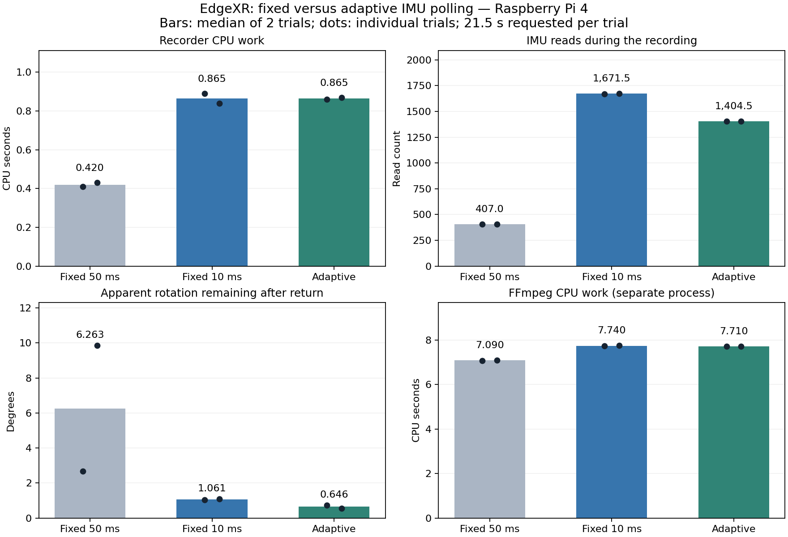

# IMU polling findings and what the measurements mean

Reviewed 2026-10-24. This is the record of the first orientation-quality/AP-cost
cycle on Raspberry Pi 4, aarch64 Linux 6.12.47+rpt-rpi-v8, Python 3.11.2,
camera-head-mounted SH3001, OV9281 USB camera requested 1280x720 MJPEG/30,
and passive metal heatsink. Power was recorded as unknown. Camera and IMU
observations use approximate host timing; exposure synchronization is unverified.

## What we learned in order

1. A 60-second stationary capture had roughly 18.75 IMU reads/s. Integrating
   after a ten-second still bias window produced 2.72° of apparent change over
   49.96 seconds. The estimate can drift while the rig is still.
2. The first controlled pan requested 0 → −20 → +20 → 0 degrees. With 50 ms
   post-read sleep, its final estimated rotation was 11.44° from the start,
   despite the user's observed physical return. Video supported the return:
   direct start/end matching estimated about 1.6 horizontal pixels at 320x180.
   Scene-dependent pixel shifts do not provide a calibrated angle reference.
3. The same commanded path with 10 ms sleep achieved roughly 80 reads/s and
   a 1.77° final residual. This was a different physical trial, so the difference
   alone could not isolate polling from motor variation.
4. Replaying that fast trace while retaining every fourth reading isolated
   integration sampling. Four sampling offsets produced final residuals
   7.13°, 3.44°, 13.10° and 3.24°, versus 1.77° for the full trace. All replays
   kept the same endpoints and full-rate bias. This supports sparse-sampling
   sensitivity; the fast trace itself is not independent ground truth.
5. The first instrumented fixed-rate ABBA test measured median recorder work
   of 0.415 CPU s at 50 ms and 0.885 CPU s at 10 ms, with respective residuals
   10.77° and 0.79°. See the [fixed-rate record](../benchmarks/results/imu-resource-fixed-2026-10-24.md).
6. The matched six-run three-policy comparison below demonstrated working
   adaptive control and fewer reads, but no recorder CPU saving on this workload.

## The matched three-policy result

Source revision: `a083d5f3077dd5661051d8f636cffc0aba61d546`. Six captures used
the same 21.5-second pan workload, requested camera mode, scene notes and observer,
in order 50 ms, 10 ms, adaptive, adaptive, 10 ms, 50 ms. CPU windows were about
21.44 seconds. Medians of two runs per policy were:

| Measurement | Fixed 50 ms | Fixed 10 ms | Adaptive |
|---|---:|---:|---:|
| IMU reads within requested window | 407 | 1671.5 | 1404.5 |
| Recorder CPU seconds | 0.420 | 0.865 | 0.865 |
| Recorder mean % of one logical CPU | 1.957% | 4.035% | 4.034% |
| Final rotation residual | 6.263° | 1.061° | 0.646° |
| FFmpeg CPU seconds | 7.090 | 7.740 | 7.710 |
| Combined CPU seconds | 7.510 | 8.605 | 8.575 |

Fractional read counts are medians of two integer counts. The adaptive mode
made 267 fewer reads per window, a **15.97% reduction** from fixed 10 ms.
Its fast windows lasted 17.181 and 17.190 seconds. Camera PTS rates excluding
startup stayed near 30.08 fps. Flags were all 0x0; sampled recorder/FFmpeg RSS
stayed near 38/153.5 MiB. Recorded endpoint temperatures spanned 43.816–52.095 C,
so the short trials were not thermally identical or a significance test.

The [full small JSON report](../benchmarks/results/imu-resource-three-policy-2026-10-24.json)
preserves per-run metrics and observed transitions. Raw videos/IMU CSVs remain
outside Git. The original Pi comparison command checked required adaptive
coverage against actual servo timestamps before producing the report. This
summary alone lacks those raw timestamps for independent reconstruction.

## Recorder CPU seconds versus elapsed time

Elapsed time is how long the recording lasts on a clock. CPU seconds are the
total time a processor actively executes the recorder's instructions across
its threads. Sleeping and blocked I2C waits consume wall time without necessarily
using a CPU throughout. Thus 0.865 CPU s spread over about 21.44 wall seconds
means roughly `0.865 / 21.44 * 100 = 4.03%` of one logical CPU.

The recorder includes IMU reads, CSV logging, its camera-log thread, policy
handling and our observer. FFmpeg is a different measured process. Startup,
shutdown, offline FFT analysis and the servo-controller parent are excluded.
CPU seconds do not measure electrical energy, end-to-end latency, or pure I2C
cost. All compared runs include the same resource observer.

## Return residual versus true angle accuracy

The estimator starts at zero orientation after its still bias window. After a
physical turn and return, the return residual is the magnitude of the estimated
rotation still remaining from that start. A 6° residual means the estimate
ends 6° away even if the camera physically returned. A smaller value is useful
for this return check, but errors along the path can cancel. An exact physical
return was not independently calibrated in these resource trials. The estimate
uses IMU axes and is not yet camera yaw/pitch or a world heading.

## Why fewer reads did not establish CPU savings

The adaptive policy follows servo **commands**. It requests fast reads before
the first command and idle reads after the last command plus settling. It does
not measure or estimate the servo's actual physical speed. Commanded 5°/s
can still produce brief much faster movement bursts.

The total recorder workload consists of common recording work, IMU acquisition
and CSV work, plus adaptive-control work when enabled. Adaptive mode performs
pipe checks and policy bookkeeping as well as taking fewer samples. Those costs
could offset savings, but we did not separately measure each component and
cannot claim that this is the proven cause of the equal CPU totals.

Actual recorder CPU values were 0.89/0.84 s for fixed 10 ms and 0.86/0.87 s for
adaptive. Both medians are 0.865 s. The adaptive combined difference of −0.030 s
is entirely in FFmpeg's counters and does not demonstrate an IMU CPU saving.
Ordinary trial variation and clock-tick resolution also limit small conclusions.
Likewise, 0.65° versus 1.06° from two returns does not prove adaptive is inherently
more accurate. The supported finding is fewer reads with similarly small
residuals, without a demonstrated recorder CPU or energy benefit here.

## Decision and next bounded step

Use explicit fixed 10 ms sleep as the reference for controlled orientation
experiments. Keep adaptive optional. These experiments do not change live
polling defaults. The first adaptive policy assumes a fixed base; it cannot
anticipate an unexpected whole-base movement during idle. A longer-idle workload
is a separate experiment if it reflects real application use.

The next step is [IMU-to-camera axis mapping](exec-plans/active/imu-camera-axis-mapping.md):
measure tilt separately, combine it with the existing pan data, establish signs
and a provisional coordinate mapping, then validate before applying it live.
This advances the spatial workload while retaining the AP cycle of capability,
quality check and measured cost.
