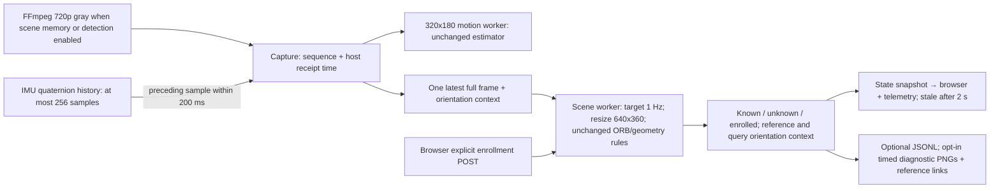
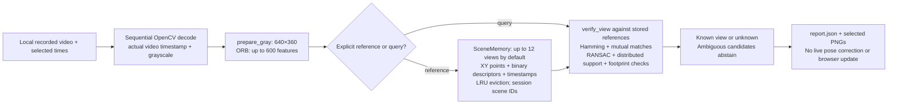
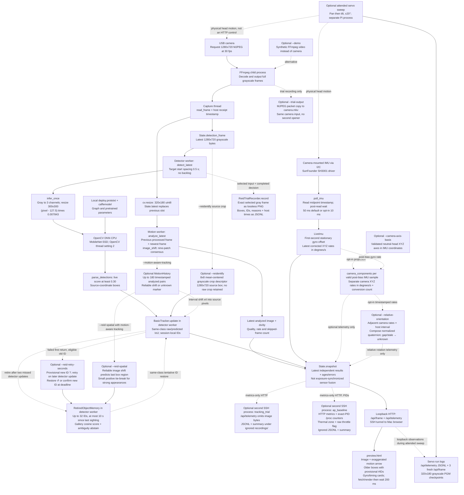

# Current live pipeline

## Separate offline scene-memory branch — 2026-10-29

The optional live route is now implemented separately as well:

This association uses host observation times, not exposure synchronization.
No scene match corrects gyro drift or supplies camera position. Unknown frames
do not automatically enroll. See [live protocol](LIVE_SCENE_MEMORY.md).

The implemented `spatial.scene_revisit` tool reads a local video, processes
explicit reference/query times chronologically, and writes a report with
selected PNGs under ignored `recordings/`. It is not connected to the live
workers or IMU. See [the scene-memory guide](SCENE_MEMORY.md).

Inputs are 16:9 uint8 grayscale after decoding. Query observations never enroll
automatically. Stored features are bounded, while private selected images stay
in the output directory. Non-increasing decoder times or incomplete decoding
produce a partial report. Offline compute timings exclude decoding/image I/O
and are not live Pi performance measurements. The existing live path follows.

An offline gyro-only experiment now reads the existing combined-capture
`imu.csv`: first still window → per-run raw gyro offset → timestamped 3D
rotation composition → relative **IMU-frame** quaternion and rotation vector.
See [the orientation guide](RELATIVE_ORIENTATION.md) and
`spatial.relative_orientation.analyze`. This runs after recording, outside the
live workers below. It does not provide camera pose or feed the browser.
`spatial.camera_axes.analyze_recordings` now also fits a **provisional offline**
IMU-to-camera basis from saved pan and tilt command legs plus physically observed
first-movement directions. It reports a neutral-pose coordinate transform and
within-run return checks; the default live worker does not consume it. See
[the camera-axis record](IMU_CAMERA_AXES.md). The optional path below does.
An independent pan check and uncovered-lens tilt check now support that offline
mapping's axis directions. `profiling.camera_axis_cost` times repeated pure
vector conversions separately from sensor reads and camera work; its rate
figures are projections. The new **opt-in** `--camera-axis-basis` path projects
each valid post-bias IMU rate into those neutral-head axes and exposes a
separately named rate/count through telemetry. The image-motion, detector and
tracker paths do not consume it. See [the A/B protocol](IMU_CAMERA_AXIS_AB.md).
With the additional opt-in `--relative-orientation` flag, those post-bias
camera-axis gyro readings also enter `RelativeCameraOrientation.add`. It starts
at identity at the still reference, averages adjacent rates over their host
read-midpoint interval, and composes a normalized quaternion. A gap over
0.2 seconds, IMU error or stale reading makes rotation unknown until restart.
The browser shows a relative angle/vector separately from the image-shift
arrow. It is not camera position, world heading, depth, image/IMU fusion or
exposure-synchronized pose; Pi quality and AP cost remain unmeasured.
For an attended physical check, a **separate**
`spatial.servo_orientation_demo` process can command a single bounded pan
then tilt sweep through the already-confirmed Fusion HAT channels 2 and 3.
It never opens the camera or reads the IMU: movement reaches the live
orientation branch only through the real head-mounted sensor. The preview
still has no servo command endpoint or autonomous continuous motor loop. The
servo process polls `/api/telemetry` about every 50 ms and stores image-free
orientation snapshots beside timestamped actual servo commands under ignored
`recordings/`. This is host-observed telemetry, not every IMU sample or camera
exposure synchronization. The [run guide](LIVE_ORIENTATION_SERVO_TEST.md)
documents the log files and failure states. The process now keeps polling for
two seconds after final commanded 0° and requires a ready sample at least one
second afterward before marking its recording complete. The
[live polling A/B protocol](LIVE_IMU_POLLING_AB.md) optionally changes the
IMU's post-read pause from 50 to 10 ms; actual read frequency remains measured.
The servo logger now also fetches three fresh 320×180 grayscale frames from
the existing loopback `/api/frame` route at still points and stores them as
ignored PGM checkpoints, without opening another camera reader.

The offline servo recorder now accepts `--imu-interval` (default 0.05 s), passed
to the combined recorder's post-read sleep. The explicit 0.01 s polling trial
is documented in [RELATIVE_ORIENTATION.md](RELATIVE_ORIENTATION.md). Actual
sample rate is measured from timestamps; this option does not alter live workers.

With `--measure-resources`, the offline combined recorder also observes itself
and its FFmpeg child at the recording cue, about 1 Hz, and before shutdown.
`profiling.capture_resources` writes CPU/RSS observations to `resources.json`;
`profiling.compare_imu_resources` combines complete fixed-rate trials with the
offline orientation residual. See [the resource protocol](IMU_RESOURCE_BENCHMARK.md).
This observer runs in the existing recording loop, outside the live graph.

The optional offline `--imu-policy command-driven` adds a servo-controller →
recorder stdin pipe. `execute_commands` requests fast reads before motion;
`CommandPolling.poll` switches post-read sleep and logs receipt. The parent
requests idle reads one second after its last servo call finishes. These
controls affect the recording experiment described in
[IMU_ADAPTIVE_POLLING.md](IMU_ADAPTIVE_POLLING.md); live workers are unchanged.

Reviewed 2026-10-21 while building the interactive
[whole-program flow explorer](learning/program-flow-explorer.html). Runtime
topology, shapes, units, worker schedules and freshness policies still match
the implementation, so the diagram itself did not need restructuring. It
includes optional motion-aware ID matching and the read-only AP collector, plus
`BasicTracker.update()` after detection parsing and an optional, bounded history
of analyzed-frame shifts. Image sizes, timing targets and freshness policies
are unchanged. The earlier
2026-10-08 learning refactor based on Desktop source at `6a53d27` changed
comments and contracts without changing the runtime path.
Read [the study index](learning/README.md)
for the end-to-end code tour. Maintain this file as code changes, as required
by [AGENTS.md](../AGENTS.md) and [the plan standard](../.agent/PLANS.md).

The diagram assumes `app.live_preview` with both `--imu` and `--detect` enabled.
Only FFmpeg is a separate child process. The capture, motion, detection and
IMU workers are Python threads in one application. OpenCV's internal threads
are distinct from those application workers. The browser runs on the Mac.

## Text fallback and mode differences

Camera -> FFmpeg -> capture reader -> two image branches: small images go to
motion analysis; full images go to slower object detection and then a sequential
box tracker before publication. With `--motion-aware-tracking`, the motion worker
also records reliable or missing shift estimates for analyzed pairs. The detector
worker asks that history for the interval between a track's last matched source
receipt and the current source receipt. The independent
I2C IMU reader supplies corrected angular rates. A snapshot combines the latest
available outputs for display, not for a shared-time estimate of camera pose.

With experimental `--reidentify`, the detector worker also computes a 64-value
grayscale crop descriptor for suitable current boxes. Each ID retains up to
four distinct views; confidence/relative-area gates protect enrollment from
weak or shrunken crops. Restored IDs keep that gallery for later returns.
Only after active IoU or
motion-aware matching fails may an unmatched detection claim a retired ID from
the worker-local, bounded memory. A `↺` label and per-update restore count mean
the provisional appearance rule fired, **not** verified physical identity.
The worker also publishes last-decision reasons by detector class,
best/runner-up scores between IDs, gallery sizes/enrollment reasons,
retained-entry count and cumulative reason counts through the
detector snapshot. These are metadata only, not raw crops or descriptors.
With `--reid-retry-seconds 2`, a failed first return can carry a provisional
new ID (`?`) for at most two host-monotonic seconds. Later matched detector
updates can restore an old ID (`↺`); the provisional ID is then superseded.
With `--motion-aware-tracking --reid-spatial`, continuously reliable image
shift predicts the old box region. A nearby return gets a 0.02 ranking bonus
only after its raw appearance score reaches 0.85. An unavailable or disagreeing
shift contributes nothing, and spatial support never rescues weak appearance.
These are opt-in experiments; default tracking and gallery-only matching are
unchanged. The IMU does not enter re-identification until camera/IMU geometry
and timing have been calibrated.
With optional `--trial-output`, the same FFmpeg camera input is also packet-
copied to a local MJPEG-in-Matroska file, and the detector worker writes its
selected 1280×720 grayscale frame (lossless PNG) alongside boxes, IDs, scores,
diagnostic reasons and host times in JSONL. The camera is not opened twice.
This recording branch is disabled by default and remains under ignored
`recordings/`; it does not feed tracking or the browser.

With detection off, FFmpeg downsizes to 320x180 before the pipe; there is no full
image slot or detector worker. With IMU off, no IMU reader is started. `--demo`
substitutes synthetic imagery only; it does not simulate gyro or detections.
Enabling `--imu` with demo still attempts a real sensor read.

The [motion-quality experiment](MOTION_QUALITY.md) is a **separate offline
path**, not an extra live worker: `combined_capture.py` records a video and IMU
log; `visual_motion.py` decodes each adjacent pair to 320×180 and records an
accepted shift or an explicit rejection; `motion_quality.py` compares four
trial CSVs. It uses saved camera PTS and approximate host IMU pairing, not the
live preview's latest-only scheduling. The experiment does not change the
diagrammed live path or its rates.
The optional [per-patch diagnostic](PATCH_DIAGNOSTICS.md) decodes the saved
video again and explains rejected pairs using the same patch gates; it is
not another live worker or a replacement displacement estimate.
The optional [servo-speed experiment](SERVO_MOTION_QUALITY.md) is likewise
outside the live diagram. It commands small, separate pan/tilt sweeps with the
Fusion HAT, runs `combined_capture.py`, then the two offline analyzers. Its
command times are host observations; its PTS-gap flag is not proven camera
frame loss. The live preview still does not command servos.

## Rates are separate controls

| Stage | Policy in code | What it does not guarantee |
|---|---|---|
| Capture | Request 30 fps, 720p MJPEG | Exposure-to-display timing or achieved downstream fps |
| Motion | Process newest frame when ready | Fixed 30 Hz or processing every captured frame |
| Detector | Start no faster than every 0.5 s | Exactly 2 results/s if compute takes longer |
| IMU | Read, then wait 0.05 s | Exactly 20 Hz or the chip's internal sampling frequency |
| Browser | Fetch/render, then wait 200 ms | Showing every processed image; refresh is below 5 Hz with overhead |

The detector's 2 Hz setting limits expensive CPU work while motion/IMU/capture
continue. It is a baseline choice, not a measured optimum. The 0.5-second
condition-wait timeout in the motion worker is not a 2 Hz throttle: a new frame
notification can wake it earlier. OpenCV's two threads are not two reserved
cores and are unrelated to the two-Hz scheduler.

## Data and timing boundaries

- Capture timestamps are monotonic host receipt times after complete pipe reads,
  before the small-image resize. They are not sensor exposure timestamps.
- IMU timestamps are midpoints of the host interval around `read_raw()`.
- Detector source age starts at that frame's capture receipt, not inference
  completion. Old boxes can overlay a newer motion image; tracking assigns
  provisional IDs but does not move displayed boxes. Boxes are hidden if older than 1.5 s
  or the camera state is not live.
- The same detector worker owns `BasicTracker` across completed results. It
  matches same-class source-pixel boxes at IoU at least 0.3, one-to-one. An
  unmatched old ID is hidden after one missed result and retired after two;
  camera frames skipped between results do not age it. IDs last only this run.
  The API carries `track_id`; ready boxes on a live camera show provisional
  `#ID` labels. A missing ID falls back to the category/confidence label.
- Motion-aware matching is opt-in and requires `--detect`. The history holds at
  most 180 analyzed pairs; an unreliable result or a pair gap over 0.12 s is
  unknown, not zero shift. Interval lookup requires continuous coverage and
  prorates partial endpoint pairs. It translates an old box by image-content
  shift scaled from 320x180 to 1280x720 pixels (factor four), then compares
  predicted and raw IoU. The higher overlap can claim an ID under the same
  class/0.3/one-to-one rules. Missing or implausible motion falls back to raw
  overlap. Snapshot counts show covered old tracks, fallbacks and ID matches
  that specifically needed motion. This is scene translation, not camera pose;
  neither gyro nor appearance features enter this matcher.
- IMU values become stale above 300 ms; startup without samples has a separate
  two-second check. Camera results become stale above two seconds and have a
  ten-second no-analyzed-frame startup check.
- Ages are measured on the Pi and exclude SSH/browser delay. The HTTP snapshot
  reads separately protected state objects; it is not one simultaneous sample.
- Bounded latest slots prevent an application history queue; this does not mean
  drivers, pipes or networking have no buffers. A worker can still hold its
  current frame while the capture slot is replaced.

## Other input/output paths

Model files and command-line options configure execution. Host clocks supply
timing measurements. FFmpeg stderr is drained by a diagnostic thread; it is
not mixed with raw pixels. Ctrl+C and the shared stop event end workers. The
HTTP server serves only the page and two fixed snapshot routes, not arbitrary
files. `/api/telemetry` omits `pixels_b64` from the usual snapshot. The optional
`vision.tracking_trial` process polls that route and saves local metrics/boxes,
not image frames. It is not another camera reader or tracking worker, and
polling may miss a detector update between requests.

The optional `profiling.ap_baseline` process also polls that route, which adds
the preview and FFmpeg PIDs without image bytes. It samples those exact
processes' CPU ticks/RSS through `/proc`, aggregate host CPU, thermal zone 0
and the raw firmware throttle flag after a warm-up. One-second polls are
sequential host observations and may repeat the same detector result; the
summary counts distinct detector sequences. It does not change frame, IMU or
detector worker rates or measure electrical power/exposure-to-display delay.
See [the run protocol](AP_BASELINE.md) and [code guide](learning/AP_BASELINE.md).

The live preview saves no footage, commands no servo and reads no usable
magnetometer/barometer stream. Acceleration and temperature returned with the
gyro are discarded by the live reader. Recording, gyro integration and saved
image benchmarking are separate commands linked from the study guides.

## Goal versus implementation

Current: observe scene displacement, recognize object categories, show
session-local IDs, optionally use measured image shift to help match IDs during
moderate turns, and measure angular rate concurrently. Future: validate this
mode on the Pi, align sensor timing and coordinate frames, and better distinguish
moving objects from a moving observer.
Calibrated object identity, long-term or cross-run memory, camera pose,
IMU-driven box correction and full spatial mapping are not implemented.

Review for the offline [basic tracker lesson](learning/basic-tracker.html):
`detect_latest` now calls `vision.basic_tracker.BasicTracker` between inference
and `DetectionState.publish`. The page is still only a teaching simulation; it
does not add a worker or depict optional history-assisted comparison. See
[the motion-aware lesson](learning/MOTION_AWARE_TRACKING.md).

## Diagram-update checklist for every implementation task

- [ ] Check entry points, optional modes and process/thread boundaries.
- [ ] Check shapes, units, model inputs, queues and ownership.
- [ ] Check rates, clocks, freshness thresholds and error paths.
- [ ] Check browser outputs and distinguish current from future features.
- [ ] Update the three guides and source references with the code change, or
  explicitly record "diagram reviewed; unchanged" and why.
